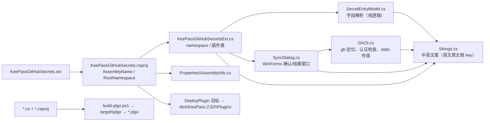

# AGENTS.md

KeePass 2 插件：把条目里的自定义字段当作 GitHub Actions secrets，点击按钮后通过本机已认证的
`gh` 推送出去。用户可读的说明在 [README.md](README.md) / [README.zh-CN.md](README.zh-CN.md)，
本文件只写开发要用的事实。

## 现状

- 从官方 SamplePlugin 改名而来，**改名已完成**，功能已实现：条目右键 → `Sync to GitHub Secrets…`
  → 勾选仓库/密钥 → 后台逐个 `gh secret set`。
- 骨架文件仍保留官方 GPL 版权头（`KeePassGitHubSecretsExt.cs`、`Properties/AssemblyInfo.cs`），
  新文件头部是同一许可的简短声明。
- `README.md`（英文）与 `README.zh-CN.md`（中文）是设计契约，写代码前先看字段约定。

## 环境（本机实测）

| 项 | 值 |
| --- | --- |
| 构建 | VS 18 BuildTools 的 MSBuild：`C:\Program Files (x86)\Microsoft Visual Studio\18\BuildTools\MSBuild\Current\Bin\MSBuild.exe` |
| .NET SDK | **没装**（`dotnet --version` 报 No SDKs），所以用 `msbuild`，不要写 `dotnet build` |
| 目标框架 | .NET Framework 4.6.2 —— 必须与 `KeePass.exe`（2.62，.NET Framework 版）一致 |
| KeePass | `dist\KeePass-2.62\KeePass.exe`（绿色版，`dist` 被 `.gitignore` 的 `/dist` 忽略） |
| 测试库 | `dist\data\test-database.kdbx`，主密码 `test` |
| `gh` | 2.100.0，`gh auth status` 已登录 `shijianjs`（keyring），scopes 含 `repo` |
| scoop | `$env:SCOOP = S:\software\scoop`，`gh.exe` 在 `S:\software\scoop\shims\gh.exe` |
| 构建输出 | `..\..\Build\SamplePlugin\<Configuration>\`（即 `S:\workspace\github\Build\...`，仓库之外） |

## 构建、部署、运行

```powershell
# 构建（sln 与 csproj 都可以）
& "C:\Program Files (x86)\Microsoft Visual Studio\18\BuildTools\MSBuild\Current\Bin\MSBuild.exe" `
  SamplePlugin.sln /p:Configuration=Release /v:minimal

# csproj 自带的 DeployPlugin 目标会把 DLL 拷到 dist\KeePass-2.62\Plugins\
# 手工部署就是同一个动作：把 <AssemblyName>.dll 复制进该 Plugins 目录
```

打开 `dist\KeePass-2.62\KeePass.exe`，KeePass 会把 `Plugins\` 下的 DLL 当作插件加载；插件加载
失败会在启动时弹提示，也可以在「工具 → 插件」里看列表。

## 测试库现状（写测试前必读）

`dist\data\test-database.kdbx`（密码 `test`）：根组下已有一条按约定建好的 `github-actions`：

```text
GitHubRepos   = shijianjs/keepass-github-secrets
                https://github.com/shijianjs/keepass-github-secrets   (重复行，会被去重)
                # comment line, ignored                               (注释，会被忽略)
                not-a-repository-line                                 (非法行，进 warnings)
                shijianjs/keepass-github-secrets-does-not-exist       (失败路径：gh 回 404)
TEST_SECRET_ALPHA      = dummy（受保护字段）
TEST_SECRET_BETA       = dummy（明文）
bad name               = dummy（字段名含空格，被跳过并进 warnings）
```

另外两条 `Sample Entry`、`Sample Entry #2` 是库自带的，不参与测试。库里没有 `devpass` 分组，
那属于旧 PowerShell 脚本用的私有库 `devpass.kdbx`。

试验目标是 `https://github.com/shijianjs/keepass-github-secrets`（本仓库）。验证方式是
`gh secret list --repo shijianjs/keepass-github-secrets`（值不可见，属正常）；清理由
`gh secret delete TEST_SECRET_ALPHA --repo shijianjs/keepass-github-secrets`。

## 验证插件真的被加载（改完必跑）

看不看界面都行，命令行就能确认：

```powershell
msbuild KeePassGitHubSecrets.sln /t:Rebuild /p:Configuration=Release
pwsh -File .\check-plugin-load.ps1 -Run    # 退出码 0 = 已加载
```

原理：KeePass 把加载过的插件 DLL 的 SHA-256 写进 `dist\KeePass-2.62\KeePass.config.xml`
的 `<PluginCompatibility>`（`@<hash>@2.62.0.0@1`），**只在正常退出时写**。脚本先比对哈希，
`-Run` 再临时去掉 `<LastUsedFile>`（否则启动卡在主密码对话框，命令行关不掉）、起停一次
KeePass、还原配置并把这次的记录补回去。必须 `/t:Rebuild`：增量构建可能跳过编译，哈希不变，
验证就没有意义。脚本会打印 `Product`/`Title`/`Version`，并在 `ProductName` 不是
`KeePass Plugin` 时直接退 2。

`SyncDialog` 之外的部分还能脱离 KeePass 单测：临时目录写控制台 harness，引用
`dist\KeePass-2.62\KeePass.exe` 与插件 DLL，打开测试库后逐对调用
`SecretEntryModel.Analyze(entry)` + `GhCli.SetSecret`。运行目录要有 `KeePass.exe` 与
`KeePassLibN*.dll`，编译器用 `MSBuild\Current\Bin\Roslyn\csc.exe`。

## PLGX 打包与验证

DLL 只能进官方签名的 KeePass；要支持自定义构建，就打 PLGX（源码包，KeePass 加载时自己编译）。

```powershell
pwsh -File .\build-plgx.ps1            # 暂存 target\plgx\KeePassGitHubSecrets\ → 包装 → 装进 Plugins\
pwsh -File .\build-plgx.ps1 -Verify    # 再起一次 KeePass，确认 PluginCache 出现新编译的 DLL
```

- 打包器就是 `KeePass.exe --plgx-create <绝对路径>`，路径不能是相对路径；输出
  `<暂存目录名>.plgx`，所以暂存目录必须叫 `KeePassGitHubSecrets`。
- **KeePass 打包的是整个暂存目录**，不是 `.csproj` 的 `<Compile>` 列表：`dist\`（100 MB 的
  KeePass）绝不能进暂存目录，否则 PLGX 会变成大包。脚本只拷 `*.cs` + `Properties\AssemblyInfo.cs`
  + 改写过的 `.csproj`（去掉 `Content`/`DeployPlugin`，补 `<LangVersion>5</LangVersion>`）。
- **PLGX 只能编译 C# 5**（用 .NET 自带编译器）。写代码时别引入 `$"…"`、`?.`、`nameof`、
  模式匹配等 C# 6+ 语法，否则 DLL 能编、PLGX 加载时报编译失败。
- 加载验证看缓存：`%LOCALAPPDATA%\KeePass\PluginCache\<hash>\KeePassGitHubSecrets.dll`，时间戳
  是首次加载那一刻；没有新条目就说明 PLGX 编译失败（加 `--debug` 会落编译日志）。
- `Plugins\` 里 DLL 优先于 PLGX。想真正走 PLGX 路径，就得把 DLL 挪走（脚本默认挪到
  `dist\dll-backup\`，`-KeepDll` 可跳过）。

## 代码约定

- **DLL 名 = 命名空间名 = 插件类名前缀**（KeePass 按文件名找 `Plugin` 子类）：最终是
  `KeePassGitHubSecrets.dll` / `namespace KeePassGitHubSecrets` / `KeePassGitHubSecretsExt`。
- 字段名常量集中定义（`GitHubRepos` 及标准字段名用 `PwDefs.*`），不要在代码里散落字符串。
- **secret 只走 stdin**：`gh secret set NAME --repo OWNER/REPO`，值写进 `StandardInput`，
  绝不拼进 `Arguments`（会进进程列表）。这是旧脚本里唯一必须原样保留的安全细节。
- 值不落日志、不落文件、不进对话框；结果表只显示字段名、长度、退出码、`gh` stderr 首行。
- 插件不写数据库：只 `Strings.ReadSafe` 读字段。要「回写同步时间」之类的功能得先改 README。
- `gh` 调用放到后台线程，UI 线程只更新进度与结果（`Process.WaitForExit` 不能跑在 UI 线程上）。
- 目标仓库只能来自 `GitHubRepos` 字段，对话框不提供自由输入。
- **界面文案一律走 `Str.T` / `Str.F`，不要在代码里直接写英文**。`Strings.cs` 里英文原文就是 key，
  中文是唯一另一语言；语言取自 `KeePass.Program.Translation.Properties.Iso6391Code`（`zh*` 即中文），
  取不到时回落到 Windows 显示语言。新增一条文案必须同时补中英两份。
- **窗口按 DPI 缩放**：`SyncDialog` 用 `Graphics.DpiX / 96` 得到 `m_fScale`，所有坐标/尺寸过 `S()` / `Sz()`
  换算，`AutoScaleMode = None`；布局用 `TableLayoutPanel`，不要再写死 `Location`（200% 缩放下必炸）。
- 文件编码/换行保持仓库现状：`.cs` 与 `AssemblyInfo.cs` 是无 BOM 的 UTF-8，`.csproj` / `.sln`
  带 BOM，源码全 CRLF；新增文档用 UTF-8 无 BOM + LF（与 README 一致）。

## 文件与命名



命名是硬约束（KeePass 按文件名找插件类）：**DLL 文件名 = 命名空间 = 插件类名去掉 `Ext`**。
改任一处都要三处一起改，否则表现为「插件目录里有文件但菜单不出现」。`Plugins` 目录里只能留
一个同名 DLL，旧的 `SamplePlugin.dll` 必须删掉。

## 与旧脚本的对应关系

旧脚本 `S:\workspace\my\local-script\keepass\KeePass-Session.ps1`（配套 `devpass.kdbx`、
`README.md`）是本次要固化的行为来源，语义逐条映射如下：

| 旧脚本 | 插件里 |
| --- | --- |
| `Invoke-KeePassSession`（加载 `KeePass.exe` 程序集、`CommonInitialize`、读主密码、打开库） | 不需要：插件运行在已解锁的 KeePass 里，直接拿 `m_host.Database` |
| `Get-KeePassSecret -Field -Title -GroupPath`（按标题 + 分组名唯一匹配条目） | 不需要：条目由右键选中，字段直接读 |
| `-Repository` 参数（一次一个仓库） | `GitHubRepos` 字段（一次一组仓库） |
| `Set-GitHubSecretFromKeePass`（`gh` 走 stdin、校验退出码） | 按钮 → 逐对执行，比原来多出结果表与错误首行 |
| `SecretName` 与 `Field` 分列两个参数 | 合并：字段名即 secret 名 |
| PowerShell 5.1 强依赖（`KeePass.exe` 是 .NET Framework 程序集，pwsh 7 加载不了） | 插件进程本身就是 KeePass，无此问题 |

旧脚本还能用的部分别删；它是这套约定来源与回归参照。

## 文档约定

- `README.md`（英文）与 `README.zh-CN.md`（中文）顶部互链，**任一改动都要同步另一份**；
  字段表、流程图、按钮名三处必须逐字一致。
- 结构与流向优先用 mermaid，不要用纯表格堆叠（本仓库 README、本文件都这么写）。
- 本文件只写「不看代码就猜不到」的事实：环境路径、构建命令、测试库密码、约定与坑；
  不抄 README 的用法说明。

## 坑

- **`AssemblyProduct` 必须是 `"KeePass Plugin"`，改不得**（`Properties/AssemblyInfo.cs`）。KeePass
  就是靠版本信息块里的 Product name 判断一个 DLL 是不是插件，写成别的值（比如插件名）会被插件
  加载器**静默跳过**，插件管理器里看不到、配置里也不写记录，且没有任何报错。Title / Description /
  Company / Copyright / Guid 都可以自由填。版本号别用 `*`（KeePass 比较版本做更新检查）。
- **不要把 `OutputPath` 之类的属性放进按 `Platform` 判条件的 PropertyGroup**。解决方案与
  Rider 传 `Platform=Any CPU`，工程默认是 `AnyCPU`，条件落空后 `OutputPath` 为空，构建直接报
  「没有为项目设置 BaseOutputPath/OutputPath」（原示例工程能用，是因为 IDE 走了另一种路径）。
  现在只按 `Configuration` 判条件，`PlatformTarget` 固定 `AnyCPU`。
- `.sln` 原本是 VS2008 格式（`Format Version 10.00`），用 VS 18 的 msbuild 会报
  `MSB4025 缺少根元素`——已改成 `Format Version 12.00` / `# Visual Studio 17`，别改回去。
- **`Get-Process KeePass | Select Modules` 看不到插件 DLL**，连已知能加载的插件也不出现；
  别用它判断「插件是否加载」。用 `check-plugin-load.ps1`（哈希比对 `PluginCompatibility`）。
- 插件 DLL 必须直接放在 `Plugins\` 根下，**放进子目录不会被加载**（官方文档说的是「把插件
  文件夹搬进去」，但 2.62 只枚举根目录的 `*.dll`）。
- 仓库根 `AGENTS.md`（`S:\workspace\github\shijianjs\AGENTS.md`）是上层目录约定，本文件优先；
  两份说的不一致时以本文件为准。
- `dist\` 与 `Build\` 都不入库；不要把 `dist\data\test-database.kdbx` 换成带真实密钥的库提交。
- 本机 `gh` 用 keyring 存凭据，**不要**在仓库里放 token、`.env`、`gh auth token` 的输出。
- **多行值会变成 LF**：KeePass 存盘时把字段里的 `\r\n` 归一化成 `\n`（实测 `L1\r\nL2\nL3\r\n` 读回
  `L1\nL2\nL3\n`），插件把读到的值原样写进 `gh` 的 stdin（UTF-8 无 BOM、不加尾随换行），
  与旧脚本 `StandardInput.Write($secret)` 行为一致。末尾是否留换行取决于字段本身。
