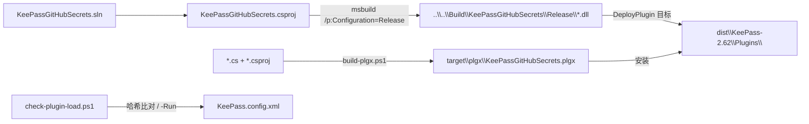
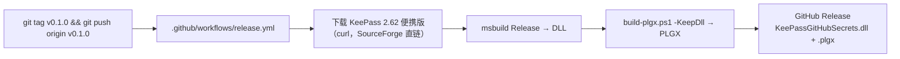

# 开发文档

面向改代码的人：环境、构建、PLGX 打包、加载验证、发版。给 AI agent 的硬性约定在
[AGENTS.md](AGENTS.md)，本文不重复那部分。

## 环境

| 项 | 本机实测 |
| --- | --- |
| IDE | Rider（解决方案 `KeePassGitHubSecrets.sln` 可直接打开） |
| 构建器 | MSBuild（VS Build Tools），**没有 .NET SDK**，所以用 `msbuild`，不要写 `dotnet build` |
| 目标框架 | .NET Framework 4.6.2（与 `KeePass.exe` 一致） |
| 测试 KeePass | `dist\KeePass-2.62\KeePass.exe`（绿色版，64 位进程） |
| 测试库 | `dist\data\test-database.kdbx`，密码 `test` |
| 命令行工具 | `gh` 2.x，已 `gh auth login`；`pwsh` 用于脚本 |

`dist\` 是本地测试环境，**不进版本库**；`KeePassGitHubSecrets.csproj` 的 `HintPath`
指向 `dist\KeePass-2.62\KeePass.exe`，所以没有 `dist\` 时先解压一份 KeePass 便携版进去。

## 目录与产物



源码分工见 AGENTS.md 的「文件与命名」图；本文只关心产物怎么出来。

## 构建 DLL

```powershell
msbuild KeePassGitHubSecrets.sln /t:Rebuild /p:Configuration=Release /v:minimal
```

- 输出在 `S:\workspace\github\Build\KeePassGitHubSecrets\Release\KeePassGitHubSecrets.dll`，
  `DeployPlugin` 目标会把它拷进 `dist\KeePass-2.62\Plugins\`，所以构建完直接启动
  `dist\KeePass-2.62\KeePass.exe` 就能试。
- 只想装进正式 KeePass：把 DLL 放进 KeePass 的 `Plugins` 目录再重启。
- 工程只按 `Configuration` 做条件，**不按 `Platform`**：IDE 会传 `Platform=Any CPU`，按平台判条件
  会让 `OutputPath` 落空（报「没有设置 BaseOutputPath/OutputPath」）。
- 版本信息块里 `AssemblyProduct` **必须逐字是 `KeePass Plugin`**，否则 KeePass 静默跳过这个 DLL；
  其余字段（Title/Company/Copyright）自由。

## 打包 PLGX

PLGX 是源码包，KeePass 加载时自己编译，所以能用在自定义构建上。打包器就是 KeePass 本身。

```powershell
pwsh .\build-plgx.ps1          # 暂存 → 打包 → 装进 dist\KeePass-2.62\Plugins\
pwsh .\build-plgx.ps1 -Verify  # 再起一次 KeePass，确认 PluginCache 里出现新编译的 DLL
pwsh .\build-plgx.ps1 -KeepDll # 不把已有 DLL 挪走（默认挪到 dist\dll-backup）
```

脚本做的事：

1. 把 `*.cs`、`Properties\AssemblyInfo.cs` 和改写过的 `.csproj` 拷到
   `target\plgx\KeePassGitHubSecrets\`（暂存目录名决定 `.plgx` 文件名）；
2. 调 `KeePass.exe --plgx-create <绝对路径>`（**相对路径不工作**）；
3. 把产物装进 `Plugins\`。`Plugins\` 里 DLL 优先于 PLGX，所以默认把 DLL 挪到 `dist\dll-backup\`，
   否则测的永远是 DLL。

要点：

- KeePass 打包的是**整个暂存目录**，不只是 `.csproj` 的 `<Compile>` 列表。`dist\`（100 MB）绝不能
  进暂存目录。
- 暂存 csproj 去掉 `Content`/`DeployPlugin`，补 `<LangVersion>5</LangVersion>`：PLGX 用 .NET 自带
  编译器，**只支持 C# 5**（别写 `$"…"`、`?.`、`nameof`、模式匹配）。
- 发布时 DLL + PLGX 一起给（双包），用户按自己的 KeePass 选一个。

## 验证插件真的被加载

界面之外也能验证，改完代码必跑：

```powershell
msbuild KeePassGitHubSecrets.sln /t:Rebuild /p:Configuration=Release
pwsh -File .\check-plugin-load.ps1 -Run   # 退出码 0 = 已加载
```

DLL 路径：KeePass 把加载过的 DLL 的 SHA-256 写进 `dist\KeePass-2.62\KeePass.config.xml` 的
`<PluginCompatibility>`（`@<hash>@2.62.0.0@1`），**只在正常退出时写**。脚本先比对哈希，`-Run`
会临时去掉 `<LastUsedFile>`（否则启动卡在主密码对话框关不掉）、起停一次 KeePass、跑完还原配置。
必须 `/t:Rebuild`：增量构建可能跳过编译，哈希不变，验证就没意义。

PLGX 路径：KeePass 首次加载时把源码编译进
`%LOCALAPPDATA%\KeePass\PluginCache\<hash>\KeePassGitHubSecrets.dll`，看这个文件的时间戳即可；
`build-plgx.ps1 -Verify` 就是干这个的（要求验证时 KeePass 没在运行）。

`Get-Process KeePass | Select Modules` **不能**用来判断加载：托管程序集不在模块列表里，位数也可能
对不上。

## 测试库

`dist\data\test-database.kdbx`（密码 `test`）根组里的 `github-actions` 条目：

| 字段 | 内容 |
| --- | --- |
| `GitHubRepos` | 若干合法仓库、一条重复的 https 行、`#` 注释行、一行非法格式、一个不存在的仓库 |
| `TEST_SECRET_ALPHA` / `TEST_SECRET_BETA` | 用于验证写入成功的正常 secret |
| `bad name` | 非法 secret 名，应被标为跳过 |

端到端试验会真的往 GitHub 写 secret：测试完记得
`gh secret delete TEST_SECRET_ALPHA --repo shijianjs/keepass-github-secrets`（`TEST_SECRET_BETA` 同）。

`SyncDialog` 以外的逻辑可以脱开 KeePass 单测：临时目录里写控制台 harness，引用
`dist\KeePass-2.62\KeePass.exe` + 插件 DLL，打开测试库后逐对调用
`SecretEntryModel.Analyze(entry)` + `GhCli.SetSecret`；运行目录需要 `KeePass.exe` 与
`KeePassLibN*.dll`，编译器用 `MSBuild\Current\Bin\Roslyn\csc.exe`。

## 发版

发布由 GitHub Actions 完成，流程是「打 tag → CI 构建 → 自动建 release 并挂附件」：



- 工作流只对 `v*` tag 触发（也可 `workflow_dispatch` 手动跑），不对每次 push 跑，避免无意义 CI。
- 版本号来源：`Properties\AssemblyInfo.cs` 的 `AssemblyVersion`（当前 `0.1.0.0`），tag 与之对应（`v0.1.0`）。
- 本地补一次手工 release 也可以用 `gh release create v0.1.0 --generate-notes <文件...>`。
- CI 里不弹 GUI，所以只验证到「打包成功」；PLGX 是否真能编译仍以本机
  `build-plgx.ps1 -Verify` 为准。

## 编码与文档约定（摘要）

- `.cs` / `AssemblyInfo.cs`：UTF-8 无 BOM + CRLF；`.csproj` / `.sln` 带 BOM；文档 UTF-8 无 BOM + LF。
- 界面文案一律走 `Str.T` / `Str.F`（英文原文做 key，中文是唯一另一语言），新增文案补中英两份。
- 窗口尺寸全过 `S()` / `Sz()`（按 `Graphics.DpiX / 96` 缩放），布局用 `TableLayoutPanel`。
- secret 只走 stdin，不进命令行；值不落日志、不进对话框。
- 文档里能画的结构用 mermaid。

更细的规则（命名硬约束、字段常量、线程约束等）见 [AGENTS.md](AGENTS.md)。

## 坑（踩过的）

| 现象 | 原因 |
| --- | --- |
| 插件目录里有文件，菜单不出现 | `AssemblyProduct` 不是 `KeePass Plugin`；或 DLL 放在 `Plugins` 子目录；或 DLL 名与命名空间/插件类前缀不一致 |
| 改了名之后「编译不了也加载不了」 | 改名要同时改 sln/csproj、`AssemblyName`/`RootNamespace`、源码 namespace、插件类名，以及 `.csproj` 的 `Compile` 列表 |
| msbuild 报 `MSB4025` | `.sln` 还是 `Format Version 10.00`（VS2008），改成 `12.00` + `# Visual Studio 17` |
| `OutputPath` 为空 | csproj 按 `Platform` 判条件（见上文） |
| PLGX 打出来特别大 | 暂存目录里混进了 `dist\` |
| PLGX 首次加载编译失败 | 源码用了 C# 6+ 语法 |
| 200%（4K）缩放下对话框错乱 | 写死了像素坐标；用 `S()`/`Sz()` + `TableLayoutPanel` |
| `PluginCompatibility` 里查不到刚构建的 DLL | 增量构建没重编（哈希没变），或 KeePass 没正常退出 |

行为来源是旧脚本 `S:\workspace\my\local-script\keepass\KeePass-Session.ps1`，逐条对应关系见
[AGENTS.md](AGENTS.md) 的「与旧脚本的对应关系」。
