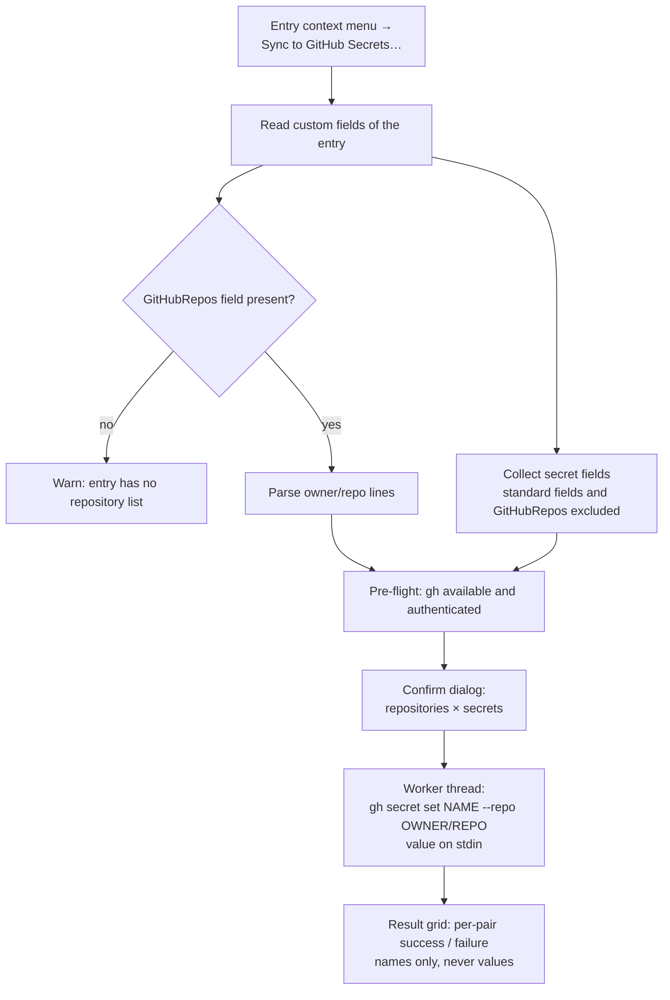

# keepass-github-secrets

**English** | [简体中文](README.zh-CN.md)

Push the secrets you keep as custom fields in one KeePass entry straight into GitHub Actions secrets,
using the locally authenticated [`gh`](https://cli.github.com/) CLI. No token stored in the plugin,
no copy of the database, no per-repository script.

## Install

1. Download the latest release: [`Releases`](https://github.com/shijianjs/keepass-github-secrets/releases).
2. Drop **one** of the two files into your KeePass `Plugins` folder and restart KeePass:

| File | Use it when |
| --- | --- |
| `KeePassGitHubSecrets.dll` | Your KeePass is an official build (the portable ZIP from keepass.info). Faster to load; KeePass will ignore the PLGX if both are present. |
| `KeePassGitHubSecrets.plgx` | Your KeePass is a custom/unsigned build (some Linux distributions, self-compiled). KeePass compiles the plugin itself on first start. |

Both are the same plugin; ship only one unless you want a dual package.

## Quick start

1. Create an entry, e.g. `github-actions`, in the group where you keep automation credentials.
2. Add the custom field `GitHubRepos` and list the target repositories, one per line:

   ```text
   shijianjs/keepass-github-secrets
   shijianjs/duckfn
   ```

3. Add one custom field per secret; the **field name is the GitHub secret name**:

   ```text
   HUB_RELEASE_TOKEN            → value
   MAVEN_CENTRAL_SIGNING_KEY    → value
   ```

4. Right-click the entry → **Sync to GitHub Secrets…** (中文界面显示 **同步到 GitHub Secrets…**),
   untick anything that should not be pushed this time, press **Sync**.
5. One grid row per repository × secret shows the exit status and, on failure, the first line of
   `gh`'s error message.

The database is never written back: the plugin only reads fields and talks to GitHub.

## Field layout

| Field | Kind | Meaning |
| --- | --- | --- |
| `GitHubRepos` | custom, plain text | Target repositories, one `owner/repo` per line. `https://github.com/owner/repo` is accepted too; blank lines and `#` comments are ignored. |
| `Title`, `UserName`, `Password`, `URL`, `Notes` | standard KeePass fields | Ignored. |
| any other custom field | protected or plain | **Name = GitHub secret name, value = the secret.** |

Rules that follow from that:

- the field name must be a legal GitHub secret name (`^[A-Za-z_][A-Za-z0-9_]*$`); illegal names are
  listed in the dialog as skipped, never pushed;
- repository lines must be legal `owner/repo`; malformed lines are reported and skipped;
- values are read through `ProtectedString.ReadSafe`, so the field's "protect" flag changes nothing.

## How it works



## Requirements

- Windows, KeePass 2.x (classic .NET Framework build, e.g. 2.62).
- `gh` 2.x on `PATH` (or under `%SCOOP%\shims`, `%USERPROFILE%\scoop\shims`), already logged in
  with `gh auth login`.
- The authenticated account needs permission to write secrets on every target repository —
  otherwise `gh` returns `HTTP 403` / `HTTP 404`.

The plugin never handles a token itself: authentication is whatever `gh` already stores.

## Troubleshooting

| Symptom | Cause / fix |
| --- | --- |
| No **Sync to GitHub Secrets…** in the entry context menu | Plugin not loaded. Both files go directly into `Plugins\` (not a subfolder). A `KeePassGitHubSecrets.dll` must have been built against the same KeePass signing key; use the PLGX for custom builds. |
| `gh` not found | Install the CLI, or put `gh.exe` on `PATH` and restart KeePass. |
| `gh is not authenticated` | Run `gh auth login` once in a terminal, then retry. |
| `HTTP 404` / `HTTP 403` for a repository | Wrong `owner/repo`, or the logged-in account cannot write secrets there. |
| PLGX compile error on first start | KeePass shows the compiler output; the plugin sources need C# 5 (in-box compiler). Report the message in an issue. |

## Security notes

- Secret values go to `gh` on **stdin** only, never on the command line, so they do not show up in
  process listings.
- Values are never logged, never written to a file and never displayed — the UI shows field names
  and lengths only.
- Repositories can only come from the `GitHubRepos` field; the dialog has no free-text target.

## Development

Building, PLGX packaging, load verification and release steps live in
[DEVELOPMENT.md](DEVELOPMENT.md) (Chinese). Agent-facing conventions are in
[AGENTS.md](AGENTS.md).

## License

GPL-2.0-or-later. The skeleton is the KeePass SamplePlugin by Dominik Reichl, and the plugin ships
inside a GPL application, so the licence is kept.
