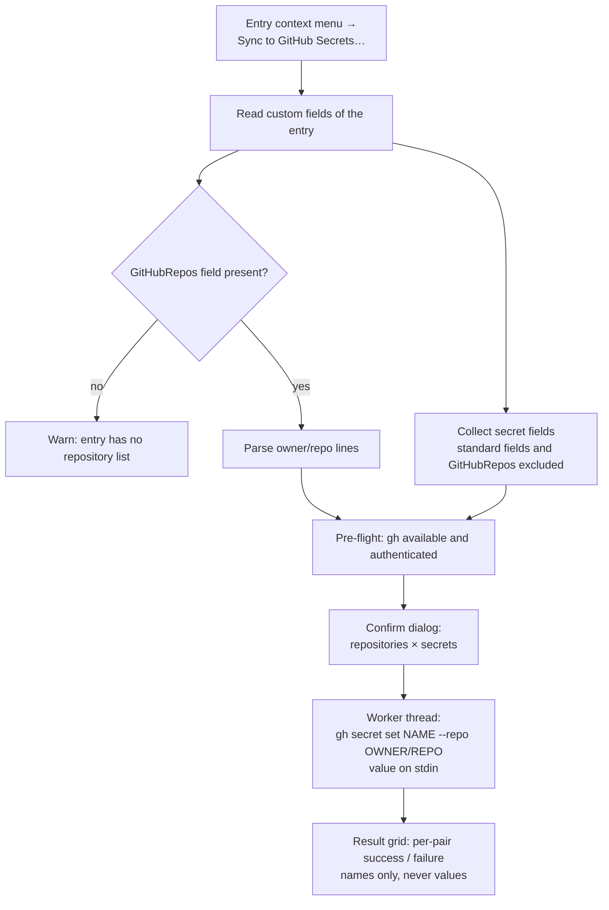

# keepass-github-secrets

**English** | [简体中文](README.zh-CN.md)

A KeePass 2 plugin that takes the secrets stored as custom fields of one entry and pushes them
into GitHub Actions secrets, using the locally authenticated [`gh`](https://cli.github.com/) CLI.

> **Status: working prototype (0.1).** The plugin builds against KeePass 2.62, loads in it, and the
> sync path has been exercised against `shijianjs/keepass-github-secrets` — including the failure
> path for a repository that does not exist.

## Why

Rotating a handful of repository secrets (Maven Central signing key, release token, …) across
many repositories used to be a PowerShell session: unlock the database, read each field by
entry title and group path, then pipe the value into `gh secret set` one call at a time.

The same job done from inside KeePass is shorter and safer:

- the database is already unlocked, so no second password prompt and no second copy of the file;
- the entry *is* the selection — no "which group, which title, which field" arguments;
- one entry can fan out to a list of repositories instead of being repeated per repository.

## How it works



## Field layout

One entry carries everything; the entry is the unit of synchronisation.

| Field | Kind | Meaning |
| --- | --- | --- |
| `GitHubRepos` | custom, plain text | Target repositories, one `owner/repo` per line. `https://github.com/owner/repo` is accepted too; blank lines and `#` comments are ignored. |
| `Title`, `UserName`, `Password`, `URL`, `Notes` | standard KeePass fields | Ignored by the plugin. |
| any other custom field | protected or plain | **The field name is the GitHub secret name, the field value is the secret.** |

Rules that follow from that:

- a field name must be a legal GitHub secret name (`^[A-Za-z_][A-Za-z0-9_]*$`); fields that are not
  are listed in the dialog as skipped, not pushed;
- a repository line must be a legal `owner/repo`; malformed lines are reported and skipped;
- values are read through `ProtectedString.ReadSafe`, so memory protection settings on the field do
  not change the behaviour.

## Usage

1. Create an entry in your database, for example `github-actions`, in whatever group you keep
   automation credentials.
2. Add the custom field `GitHubRepos` and list the repositories to write to:

   ```text
   shijianjs/keepass-github-secrets
   shijianjs/duckfn
   ```

3. Add one custom field per secret, named after the GitHub secret:

   ```text
   HUB_RELEASE_TOKEN            → value
   MAVEN_CENTRAL_SIGNING_KEY    → value
   ```

4. Right-click the entry → **Sync to GitHub Secrets…**, untick anything that should not be pushed
   this time, and press **Sync**. The UI follows KeePass' own language: in a Chinese KeePass it
   reads **同步到 GitHub Secrets…** / **同步**.
5. The result grid shows one row per repository × secret with the exit status, and the first line
   of `gh`'s error message when a call fails.

Nothing is written back to the database: the plugin only reads fields and talks to GitHub.

## Requirements

- Windows, KeePass 2.x (the classic .NET Framework build, e.g. 2.62).
- `gh` 2.x on `PATH` (or under `%SCOOP%\shims`, `%USERPROFILE%\scoop\shims`), already logged in
  with `gh auth login`.
- The authenticated account needs permission to write secrets on every target repository —
  `gh` returns `HTTP 403` / `HTTP 404` otherwise.

The plugin never handles a token itself: authentication is whatever `gh` already stores.

## Build and install

The plugin targets .NET Framework, matching `KeePass.exe`; no .NET SDK is needed.

```powershell
msbuild KeePassGitHubSecrets.sln /p:Configuration=Release
```

The `DeployPlugin` target copies the DLL into `dist\KeePass-2.62\Plugins\`, so a local test run is
just `dist\KeePass-2.62\KeePass.exe`. To install into a real KeePass, copy `KeePassGitHubSecrets.dll`
into the KeePass `Plugins` folder and restart it.

The project does **not** condition on `Platform`, only on `Configuration`: solution and IDE builds
pass `Platform=Any CPU` while the project default is `AnyCPU`, and a platform condition silently
leaves `OutputPath` empty (MSB error "no BaseOutputPath/OutputPath").

Development notes — environment, test database, the legacy PowerShell script this replaces —
are in [AGENTS.md](AGENTS.md).

## Security notes

- Secret values go to `gh` on **stdin** only, never on the command line, so they do not appear in
  process listings.
- Values are never logged, never written to a file and never shown in a dialog — the UI only shows
  field names and lengths.
- Repositories are only ever the ones listed in `GitHubRepos`; the dialog has no free-text target.

## Roadmap

- [x] rename the sample plugin (`SamplePlugin` → `KeePassGitHubSecrets`)
- [x] parse `GitHubRepos` and collect secret fields
- [x] sync dialog with repository × secret selection
- [x] `gh` runner (stdin, exit code, stderr capture) on a worker thread
- [x] end-to-end test against `shijianjs/keepass-github-secrets`
- [ ] cancel a running sync; remember the last used selection

## License

GPL-2.0-or-later. The skeleton is the KeePass SamplePlugin by Dominik Reichl, and the plugin ships
inside a GPL application, so the licence is kept.
