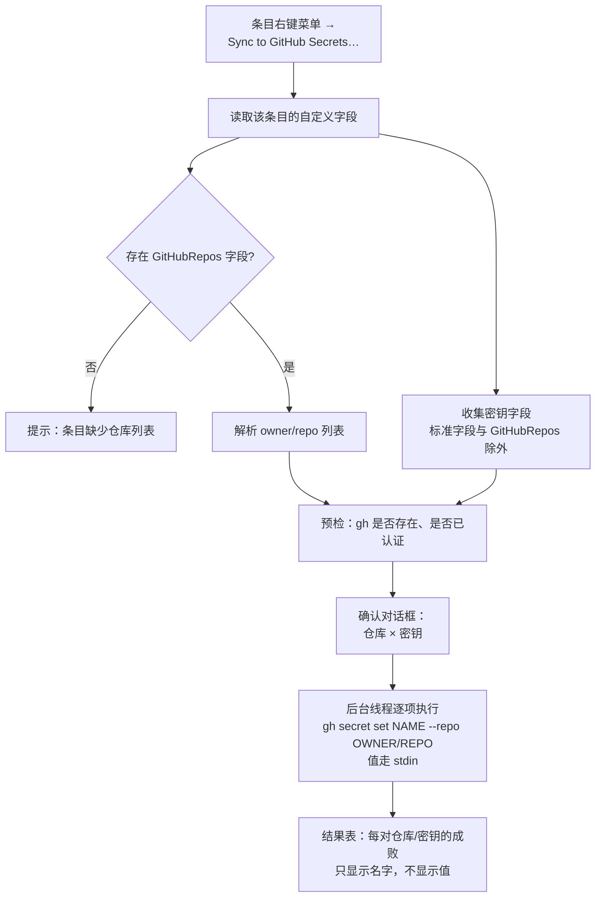

# keepass-github-secrets

[English](README.md) | **简体中文**

一个 KeePass 2 插件：把某条条目中以自定义字段形式保存的密钥，通过本机已登录的
[`gh`](https://cli.github.com/) 命令行写进 GitHub Actions secrets。

> **当前状态：可用的原型（0.1）。** 插件对着 KeePass 2.62 编译、能被它加载，同步流程已经在
> `shijianjs/keepass-github-secrets` 上跑过——包括「仓库不存在」的失败路径。

## 为什么用插件

过去轮换一批仓库密钥（Maven Central 签名钥、发布令牌等）是一个 PowerShell 会话：解锁数据库，
按「标题 + 分组路径 + 字段名」逐条读值，再一条一条把值灌进 `gh secret set`。

搬进 KeePass 里点按钮之后，同样的事短了也稳了：

- 数据库本来就是解锁状态，省掉第二次输密码、也省掉桌面上再放一份数据库副本；
- 「条目」本身就是选择范围，不用再传「哪个分组、哪个标题、哪个字段」；
- 一条条目就能对一组仓库生效，不必每个仓库重复一遍。

## 工作方式



## 字段约定

一条条目自带全部信息；条目就是同步单位。

| 字段 | 类型 | 含义 |
| --- | --- | --- |
| `GitHubRepos` | 自定义、明文 | 目标仓库，每行一个 `owner/repo`。也接受 `https://github.com/owner/repo`；空行和 `#` 注释忽略。 |
| `Title`、`UserName`、`Password`、`URL`、`Notes` | KeePass 标准字段 | 插件忽略。 |
| 其余任意自定义字段 | 受保护或明文 | **字段名 = GitHub secret 名，字段值 = 密钥本身。** |

由此推出的规则：

- 字段名必须是合法的 GitHub secret 名（`^[A-Za-z_][A-Za-z0-9_]*$`），不合格的在对话框里标为
  「跳过」，不会推送；
- 仓库行必须是合法的 `owner/repo`，格式错的会被报出来并跳过；
- 值统一走 `ProtectedString.ReadSafe` 读取，字段是否勾了「保护」不影响行为。

## 用法

1. 在数据库里建一条条目，例如 `github-actions`，放在你放自动化凭据的分组里。
2. 加自定义字段 `GitHubRepos`，写上要写入的仓库：

   ```text
   shijianjs/keepass-github-secrets
   shijianjs/duckfn
   ```

3. 每个密钥加一个自定义字段，字段名就是 GitHub 上的 secret 名：

   ```text
   HUB_RELEASE_TOKEN            → 值
   MAVEN_CENTRAL_SIGNING_KEY    → 值
   ```

4. 右键该条目 → `同步到 GitHub Secrets…`（跟随 KeePass 的界面语言：中文环境显示中文，英文环境显示
   `Sync to GitHub Secrets…`），取消掉这次不想推的项，按 **同步**。
5. 结果表按「仓库 × 密钥」逐行给出退出状态；失败时附带 `gh` 报错的第一行。

数据库不会被写回：插件只读字段、只对 GitHub 说话。

## 运行环境

- Windows，KeePass 2.x（经典 .NET Framework 版，例如 2.62）。
- `gh` 2.x 在 `PATH` 上（或在 `%SCOOP%\shims`、`%USERPROFILE%\scoop\shims`），并且已经
  `gh auth login`。
- 登录的账号对每个目标仓库都要有写 secret 的权限，否则 `gh` 会回 `HTTP 403` / `HTTP 404`。

插件自己不碰令牌：认证就是 `gh` 已经存好的那一份。

## 构建与安装

插件目标框架跟 `KeePass.exe` 一致，是 .NET Framework，不需要 .NET SDK。

```powershell
msbuild KeePassGitHubSecrets.sln /p:Configuration=Release
```

`DeployPlugin` 目标会把 DLL 拷进 `dist\KeePass-2.62\Plugins\`，所以本地试运行直接启动
`dist\KeePass-2.62\KeePass.exe` 即可。装进正式 KeePass 时，把 `KeePassGitHubSecrets.dll`
放进 KeePass 的 `Plugins` 目录再重启。

工程文件**只按 `Configuration` 做条件，不按 `Platform`**：解决方案与 IDE 传的是
`Platform=Any CPU`，工程默认却是 `AnyCPU`，按平台做条件会让 `OutputPath` 落空，直接报
“没有设置 BaseOutputPath/OutputPath”。

开发相关的环境、测试库、以及这个插件要取代的那份 PowerShell 脚本，见
[AGENTS.md](AGENTS.md)。

## 安全要点

- 密钥只经 **stdin** 交给 `gh`，不进命令行参数，所以不会出现在进程列表里。
- 值不写日志、不落文件、不在对话框里显示——界面只给字段名和长度。
- 目标仓库只能来自 `GitHubRepos` 字段，对话框里没有自由输入的仓库。

## 路线图

- [x] 把示例插件改名（`SamplePlugin` → `KeePassGitHubSecrets`）
- [x] 解析 `GitHubRepos`、收集密钥字段
- [x] 同步对话框（仓库 × 密钥 勾选）
- [x] `gh` 执行器（stdin、退出码、stderr 捕获）跑在后台线程
- [x] 拿 `shijianjs/keepass-github-secrets` 做端到端试验
- [ ] 支持中途取消；记住上次的勾选

## 许可证

GPL-2.0-or-later。骨架来自 Dominik Reichl 的 KeePass SamplePlugin，且插件运行在 GPL 程序里，
所以沿用同一许可。
