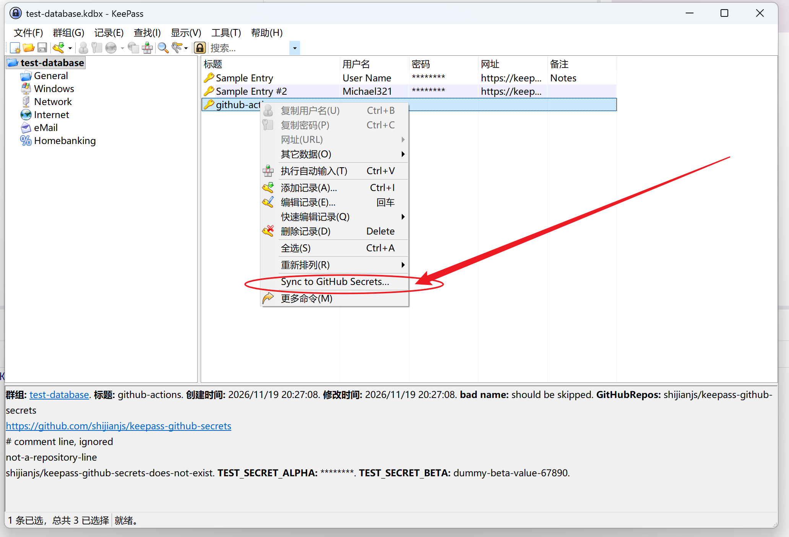
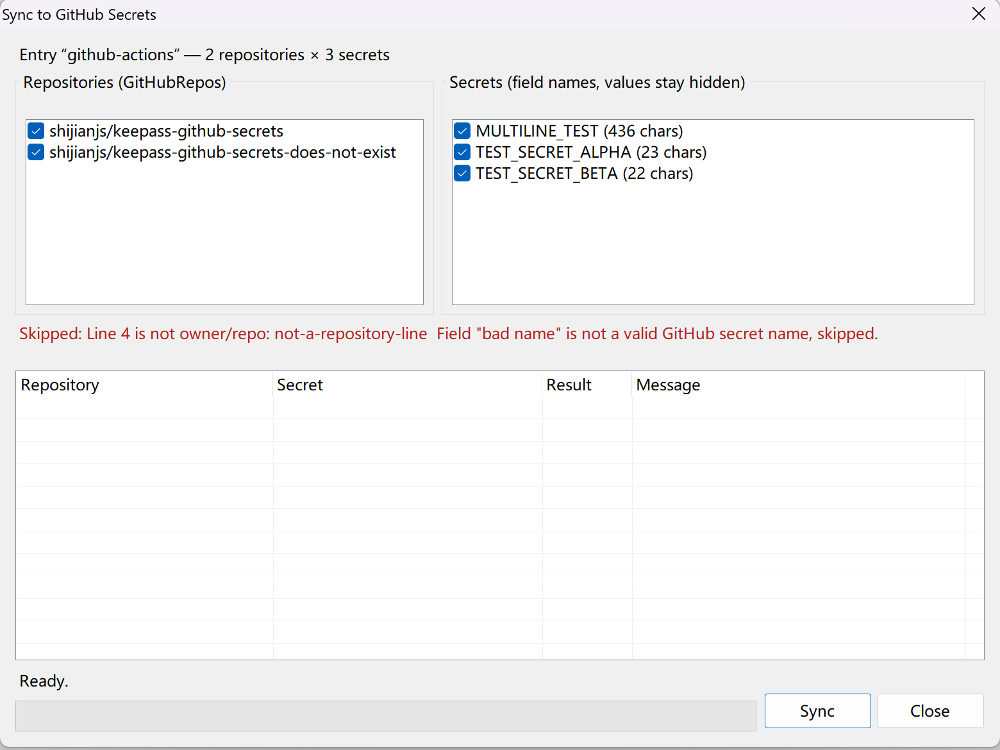
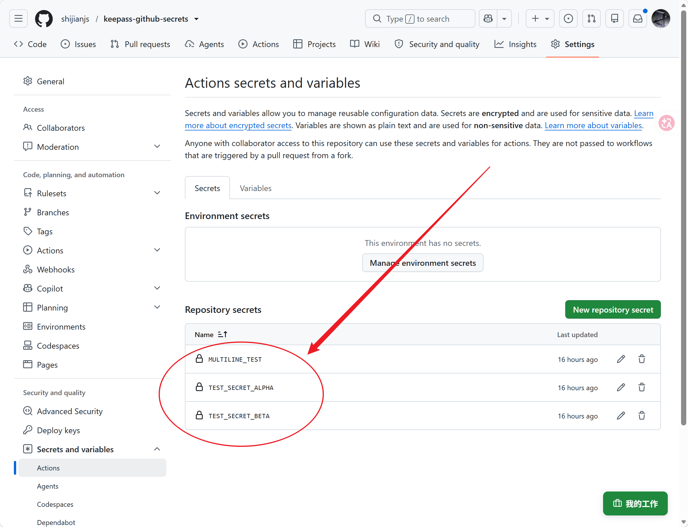
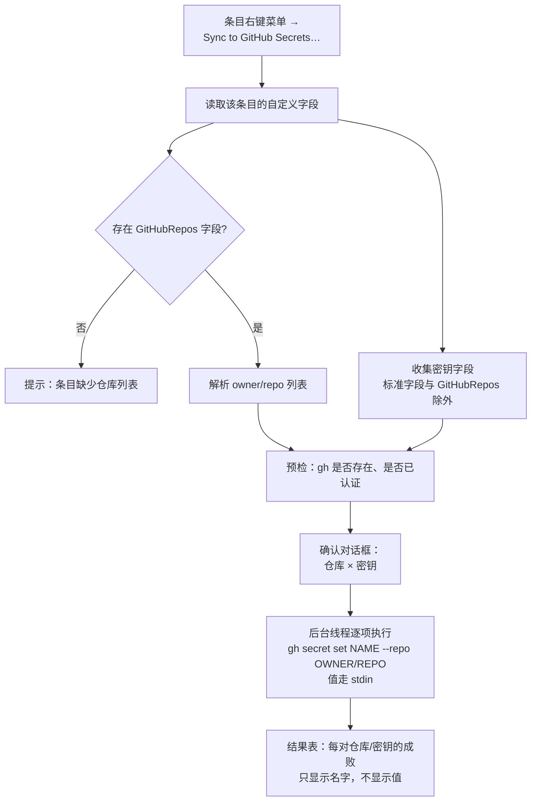

# keepass-github-secrets

[English](README.md) | **简体中文**

把某条 KeePass 条目里以自定义字段保存的密钥，通过本机已登录的 [`gh`](https://cli.github.com/)
直接写进 GitHub Actions secrets。插件里不存令牌、桌面上不放数据库副本、也不用按仓库写脚本。

## 安装

1. 到 [Releases](https://github.com/shijianjs/keepass-github-secrets/releases) 下载最新版本。
2. 把**其中一个**文件放进 KeePass 的 `Plugins` 目录，重启 KeePass：

| 文件 | 什么时候用它 |
| --- | --- |
| `KeePassGitHubSecrets.dll` | KeePass 是官方构建（keepass.info 的便携版）。加载更快；两个文件同时存在时 KeePass 会忽略 PLGX。 |
| `KeePassGitHubSecrets.plgx` | KeePass 是自定义/未签名构建（部分 Linux 发行版、自己编译的版本）。首次启动时由 KeePass 自己编译。 |

两者是同一个插件，通常只放一个；想同时兼容两类 KeePass 就两个都放（双包）。

## 快速上手

1. 建一条条目，例如 `github-actions`，放在你放自动化凭据的分组里。
2. 加自定义字段 `GitHubRepos`，每行一个目标仓库：

   ```text
   shijianjs/keepass-github-secrets
   shijianjs/duckfn
   ```

3. 每个密钥加一个自定义字段，**字段名就是 GitHub 上的 secret 名**：

   ```text
   HUB_RELEASE_TOKEN            → 值
   MAVEN_CENTRAL_SIGNING_KEY    → 值
   ```

4. 右键该条目 → **同步到 GitHub Secrets…**（英文界面显示 **Sync to GitHub Secrets…**），取消掉
   这次不想推的项，按 **同步**。
5. 结果表按「仓库 × 密钥」逐行给出退出状态；失败时附带 `gh` 报错的第一行。

入口在条目右键菜单里（截图是英文界面，中文界面显示 `同步到 GitHub Secrets…`）：



对话框长这样——左边是仓库，右边是密钥字段名和长度（值不显示），被跳过的行和非法字段名标红：



同步成功后，密钥出现在仓库的 **Settings → Secrets and variables → Actions → Repository secrets**
列表里：



数据库不会被写回：插件只读字段、只对 GitHub 说话。

## 字段约定

| 字段 | 类型 | 含义 |
| --- | --- | --- |
| `GitHubRepos` | 自定义、明文 | 目标仓库，每行一个 `owner/repo`。也接受 `https://github.com/owner/repo`；空行和 `#` 注释忽略。 |
| `Title`、`UserName`、`Password`、`URL`、`Notes` | KeePass 标准字段 | 插件忽略。 |
| 其余任意自定义字段 | 受保护或明文 | **字段名 = GitHub secret 名，字段值 = 密钥本身。** |

由此推出的规则：

- 字段名必须是合法的 GitHub secret 名（`^[A-Za-z_][A-Za-z0-9_]*$`），不合格的在对话框里标为
  「跳过」，不会推送；
- 仓库行必须是合法的 `owner/repo`，格式错的会被报出来并跳过；
- 值统一走 `ProtectedString.ReadSafe` 读取，字段是否勾了「保护」不影响行为。

## 工作方式



## 运行环境

- Windows，KeePass 2.x（经典 .NET Framework 版，例如 2.62）。
- `gh` 2.x 在 `PATH` 上（或在 `%SCOOP%\shims`、`%USERPROFILE%\scoop\shims`），并且已经
  `gh auth login`。
- 登录的账号对每个目标仓库都要有写 secret 的权限，否则 `gh` 会回 `HTTP 403` / `HTTP 404`。

插件自己不碰令牌：认证就是 `gh` 已经存好的那一份。

## 排查

| 现象 | 原因 / 处理 |
| --- | --- |
| 条目右键菜单里没有「同步到 GitHub Secrets…」 | 插件没加载。文件要直接放 `Plugins\`（不能放子目录）；`KeePassGitHubSecrets.dll` 必须与当前 KeePass 的签名密钥一致，自定义构建改用 PLGX。 |
| 提示找不到 `gh` | 装 `gh` 并确保 `gh.exe` 在 `PATH` 上，重启 KeePass。 |
| 提示 `gh is not authenticated` | 先在终端跑一次 `gh auth login`，再回来重试。 |
| 某个仓库报 `HTTP 404` / `HTTP 403` | `owner/repo` 写错，或登录账号在该仓库没有写 secret 的权限。 |
| 首次启动 PLGX 编译失败 | KeePass 会弹编译器输出；插件源码需满足 C# 5（内置编译器）。把报错贴到 issue。 |

## 安全要点

- 密钥只经 **stdin** 交给 `gh`，不进命令行参数，所以不会出现在进程列表里。
- 值不写日志、不落文件、不在界面显示——界面只给字段名和长度。
- 目标仓库只能来自 `GitHubRepos` 字段，对话框里没有自由输入的仓库。

## 开发

构建、PLGX 打包、加载验证与发版流程见 [DEVELOPMENT.md](DEVELOPMENT.md)；给 agent 看的约定见
[AGENTS.md](AGENTS.md)。

## 许可证

GPL-2.0-or-later。骨架来自 Dominik Reichl 的 KeePass SamplePlugin，且插件运行在 GPL 程序里，
所以沿用同一许可。
